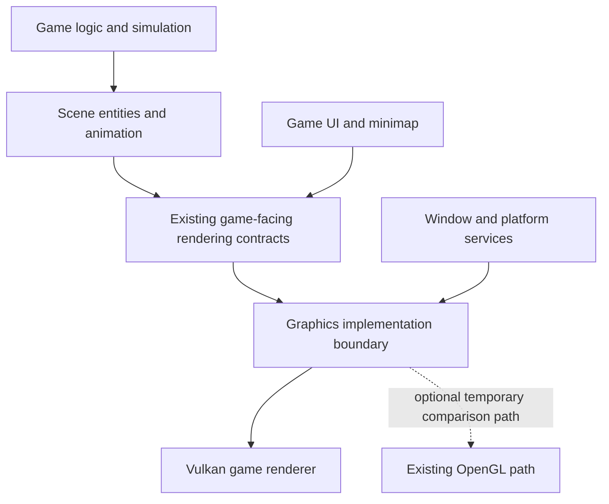

# Machines architecture and migration design

> Current baseline: WiredForWar/machines at `104862d6`. Personal experiments and private docs now live in `machines-juan-experiments`; upstream contributions live in `machines-wiredforwar`. See [the current setup and loading-screen record](migration/0010-loading-screen-and-separated-experiments.md). Sections describing the Nightdive engine and discarded Vulkan prototype are historical, not implemented functionality in these clones. The agreed preservation goals and three stages remain in effect.

**Status:** Working draft. Existing structure and the Vulkan prototype are
described as observed; target design ideas are identified as proposals.

**Last updated:** 2026-11-08

**Goals and constraints:** [Project brief](PROJECT_BRIEF.md)

**Delivery stages:** [Roadmap](ROADMAP.md)

## 1. Architectural purpose

Support a complete Vulkan port on Windows 11, faithful stabilization, and later
substantial internal modernization. The external contract is the original game
experience. Internal code and module design may evolve within that contract.

Architecture work must respect the stage boundaries. Stage one includes the
changes required for the full functional port. Stage two establishes fidelity.
Stage three permits broader refactoring and dependency/language modernization.
A broad engine rewrite is not a prerequisite for beginning the Vulkan conversion.

Ground zero precedes Vulkan integration. The community baseline has played a
Skirmish on Windows 11; the contribution source also builds natively with MSVC.
The user requires native Windows builds and tests. The earlier Docker cross-build
is historical evidence, not a current setup step.

## 2. Repository ownership

```text
github/
  machines-wiredforwar/            Independent community contribution clone
    .git/                         Branch upstream/display-scaling-preferences
    src/                          Focused fixes for upstream review
    build/                        Existing baseline and native preview runtimes
    AGENTS.md                     Destination and contribution rules
  machines-juan-experiments/       Independent personal experiment clone
    .git/                         Branch experiment/ground-zero
    src/                          Pristine upstream baseline; future Vulkan work
    juans-custom-implementation/
      README.md                   Private documentation index
      docs/                       Brief, roadmap, architecture, guides, history
    AGENTS.md                     Experiment and transfer rules
```

Each clone owns its own Git history and branches. Do not create nested source
repositories. Record the source base and keep private Vulkan experiments out of
upstream contributions. Transfer selected fixes deliberately and validate them in
the receiving checkout. Both remotes are listed in each root working agreement.

Use separate build outputs, settings, saves, and logs. Never copy an absolute-path
CMake cache between clones. The community checkout retains the known working
runtime and a separate scaling preview. The personal clone now has an isolated
HD HUD runtime using the community native executable and a separate optional
art pack. Its native image checker has a fresh build directory; a full personal
game build has not been performed.

The current implementation baseline is WiredForWar revision
`104862d63b7a09b95d318a2014f05120060ed80d`, replacing the earlier Nightdive
2020 checkout. The **1999 retail game defines fidelity**. The user does
not have the 1999 source code, and it is not required for this project. Compare
observable retail behavior with the conversion, using a documented executable,
assets, and reference environment when available. Separately record differences
inherited from the 2020 port and regressions introduced by this migration.

## 3. Existing code organization

The source organizes most engine and game functionality under `src/libdev`, with
headers under `include/libdev` and application entry points under `src/projects`.
The following map describes existing responsibilities, not newly designed layers:

| Area | Existing responsibility |
| --- | --- |
| `projects/machines` | Main game application and system orchestration. |
| `machlog`, `sim` | Game logic, AI, and simulation-related behavior. |
| `machphys`, `world4d` | Machine representation, scene entities, and renderable world behavior. |
| `render` | Devices, displays, surfaces, textures, materials, meshes, and draw operations. |
| `gui`, `machgui` | Generic and game-specific interfaces, including the minimap. |
| `afx`, `device`, `system` | SDL application/window lifecycle, input/timing, and platform/file services. |
| `network` | Networking implementation; the current build depends on ENet. |
| `sound`, `ani` | Audio and animation/video support, with associated external libraries. |
| `base`, `ctl`, `mathex`, `utility` | Shared infrastructure, containers/persistence helpers, mathematics, and utilities. |

The legacy CMake configuration uses OpenGL 2.1, SDL2/SDL2_image, GLEW, OpenAL,
ALURE, ENet, and FreeType. The source contains additional bundled dependencies.
The full game toolchain and dependency compatibility have not yet been verified
in this workspace.

### Rendering coupling

Existing public rendering classes include `RenDevice`, `RenDisplay`, `RenSurface`,
and `RenTexture`. These are useful starting points for a graphics boundary, but
they are not currently clean graphics-API-independent contracts. For example,
`RenDevice` exposes OpenGL types and shader/buffer identifiers.

OpenGL operations are spread across device/display handling, surfaces, mesh and
triangle groups, alpha/coplanar groups, stars, and the minimap. The SDL window
creation path requests an OpenGL window, and display presentation uses OpenGL
swap operations. Replacing only a central draw call cannot complete the port.

This is the principal area to inspect during the conversion. Simulation,
networking, persistence, and platform behavior also need verification rather than
an assumption that graphics changes leave every other system unaffected.

## 4. Implemented Vulkan prototype

`conversion/src/libdev/render/vulkan` contains `RenVulkanContext`, which currently
owns Vulkan instance/device setup, surface integration, queue selection,
swapchain resources, clear rendering, submission/presentation synchronization,
resize/minimize handling, and cleanup. SDL owns the window.

The standalone entry point under `conversion/src/projects/vulkan-smoke` creates
a Vulkan window and presents a background. It has frame-count, window-exercise,
and validation options. It does not execute the game loop or draw game assets.

The `MACHINES_VULKAN_BOOTSTRAP` build option selects that prototype and bypasses
the full game's dependency/build path. With it disabled, the game retains its
OpenGL implementation. Vulkan is therefore not yet integrated into the game.

The prototype uses a Vulkan 1.1 runtime baseline and pinned Vulkan-Headers/volk
sources associated with SDK 1.3.296; fallback SDL2 is 2.32.10. These describe the
current experiment. They do not settle the user's desired current-Vulkan target,
supported hardware matrix, or stage-three dependency policy.

Five shaders under `conversion/data/shaders/vulkan` translate GUI, world, and
billboard shading. They retain the existing color interpretation and fog
calculation and adapt clip-space coordinates. Compilation and interface checks
have passed, but actual scene rendering and visual fidelity remain unverified.
See the [bootstrap guide](guides/VULKAN_BOOTSTRAP.md) for technical details and
previous test results.

## 5. Proposed conversion boundary

The following is an engineering direction for discussion, not a completed or
fully specified backend API:



Start from existing contracts and isolate the necessary graphics operations
without changing game-facing semantics. A temporary OpenGL path within the
conversion may help compare refactored code, but keeping two backends is not a
permanent product requirement. The preserved `original/` source remains available
as a separate reference build.

Vulkan must become the rendering path of the complete playable game in stage
one. Full fidelity is the stage-two milestone; the prototype's earlier suggestion
to defer selecting Vulkan until after all parity checks is superseded by this
agreed roadmap.

### Responsibilities to account for

| Responsibility | Required investigation and conversion work |
| --- | --- |
| Window and presentation | SDL Vulkan window/surface ownership, swapchain recreation, display/fullscreen transitions, shutdown. |
| Resources | Vertex/index buffers, texture uploads, descriptors/uniforms, samplers, depth attachments, lifetime and synchronization. |
| Draw behavior | Existing transforms, depth rules, culling, blend modes, alpha ordering, coplanar bias, fog, and billboards. |
| Surfaces and GUI | Blits, color keys, font atlases, GUI geometry, image/video display, and texture updates. |
| Offscreen operations | Minimap targets, framebuffer readback, screenshots, and any surface-copy paths the game uses. |
| Other game systems | Input/timing, audio, save/load, network play, and their interaction with platform and render lifecycle. |

These identify coverage areas. Final ownership types, allocation strategies,
interfaces, failure handling, and resource threading policy require further
inspection and decisions; they are not fixed by this document.

## 6. Stage-three modernization principles

Substantial internal redesign and careful incremental upgrades are both allowed.
Use the faithful stage-two version as the behavioral reference during this work.

- Improve C++ practices, dependency currency, module responsibilities, interfaces,
  ownership, error handling, build clarity, testability, and maintainability.
- Preserve gameplay, graphics style, assets, simulation behavior, and inherited
  quirks according to the preservation policy.
- Treat intentional behavioral or visual changes as separate decisions.
- Explain why each architectural change helps and how preservation was checked.
- Do not select a replacement engine or add engine capabilities merely to claim
  modernization. The project goal is modern internals with the original experience.

Specific language standards, dependency replacements, compiler support, and
module boundaries remain to be agreed. No whole-engine design is being declared
final during this initial documentation round.

### Audio modernization direction

Recorded on 2026-11-08: prefer **OpenAL Soft with a modern C++ audio layer**,
and incrementally replace the old ALURE loading/streaming helper. This is the
stage-three direction, not an immediate dependency migration. Exact versions,
interfaces, and replacement decoder/streaming components remain to be selected.

The current source already uses OpenAL sources and buffers, listener position
and orientation, source gain, distance parameters, and looping, notably in
`original/src/libdev/sound/alsample.cpp` and `alsound.cpp`. Retaining these API
semantics reduces the behavior we would otherwise need to recreate. OpenAL Soft
is a maintained implementation of that API; an older API does not require an
obsolete implementation. See the [project](https://openal-soft.org/) and
[release history](https://github.com/kcat/openal-soft/releases).

Modernize ownership and cleanup of devices, contexts, buffers, and sources;
make decoding and streaming explicit and maintainable. Preserve the original
audio assets without recompression. Replace ALURE incrementally, checking its
loading, playback, and streaming behavior before removing the old path.

Pin the OpenAL Soft version and explicitly record output configuration,
resampling, spatialization, and relevant mixer settings. Do not enable new HRTF,
reverb, or other sound processing by default as part of modernization. Match
the established reference settings and behavior rather than assuming library
defaults preserve them.

Acceptance comparisons must cover volume and distance falloff, stereo/3D
positioning, listener orientation, pitch, playback timing, overlapping sounds
and source limits, finite/infinite loops, music transitions, pause/resume, and
streaming continuity. Use repeatable scenarios and reference recordings with
matched assets, hardware, and output settings; define tolerances before accepting
the replacement. Record any retained quirks and their reference provenance.

No library choice guarantees identical audio output. The faithful stage-two
build is the migration reference, with the 1999 retail experience remaining the
fidelity authority. Differences already present in the 2020 port must not be
mistaken for verified retail behavior.

[Miniaudio](https://miniaud.io/docs/manual/) is the alternative if a full playback
architecture replacement becomes justified. It provides mixing and spatialization,
but mapping the existing OpenAL behavior would add preservation work. FMOD and
Wwise were considered as broader audio systems; no move to either is planned
for this preservation-focused modernization.

## 7. Verification and architectural records

Keep practical procedures in [guides](guides/README.md) and decisions, changes,
known inherited issues, and lessons in the [migration record](migration/README.md).

Compare reference and conversion runs under matched assets, scenarios, settings,
and hardware, with independent writable runtime state. Record the source
revision, toolchain/dependencies, configuration, observations, and limitations
needed to reproduce a result. Capture performance as well as functional and
visual behavior; no performance target or fidelity threshold is agreed yet.

Prototype validation results are useful evidence for that prototype only. Stage
completion requires evidence for the full game, including multiplayer. Reference
execution setup, test coverage, tolerances, hardware requirements, and final
modernization targets remain to be defined, as recorded in the
[project brief](PROJECT_BRIEF.md#9-success-criteria-and-open-decisions).
